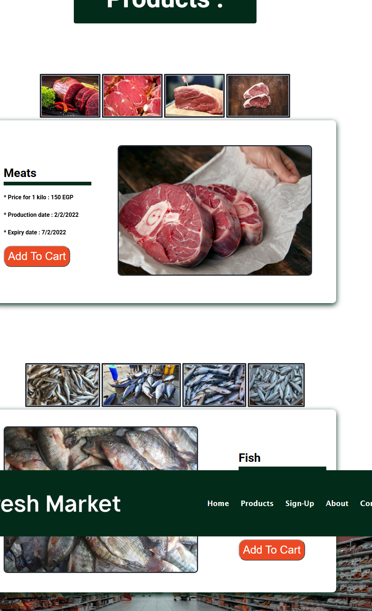
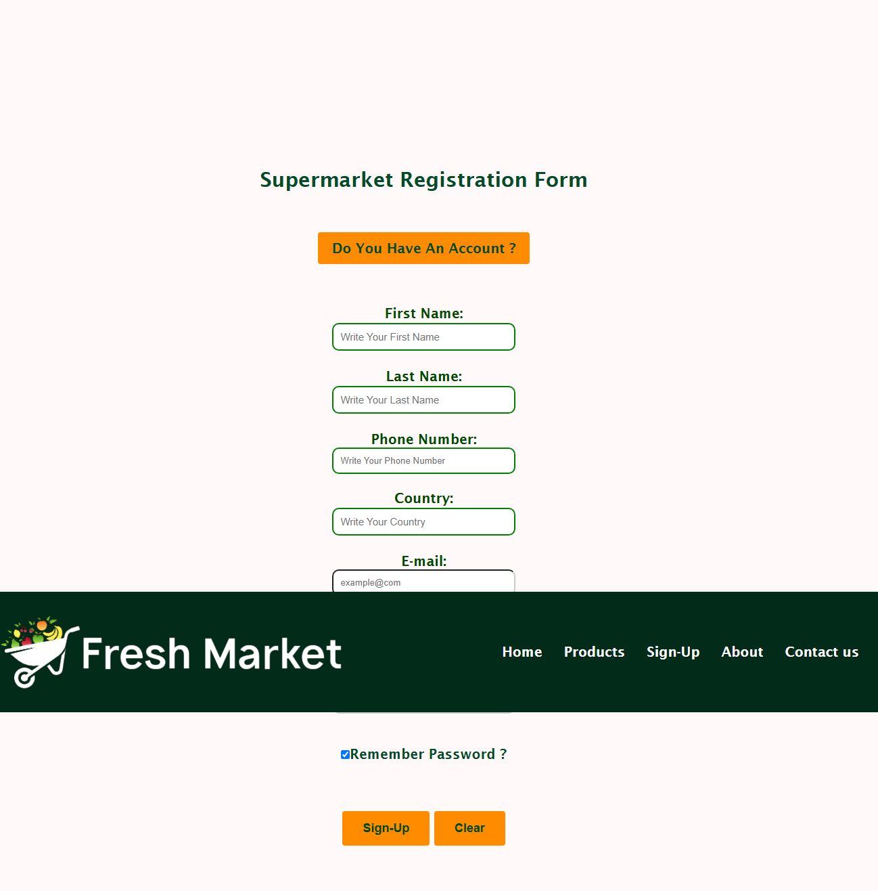
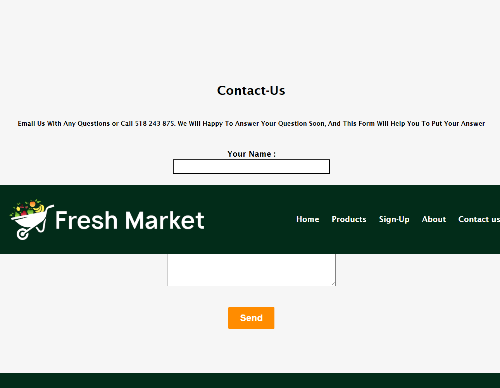

# 🛒 Fresh Market

A responsive supermarket website built with **HTML, CSS and JavaScript**. Customers can browse products by category (meats, fish, fruits, vegetables and more), see the price and production/expiry dates, and add items to their cart.

🔗 **Live Demo:** [eman8382534-dev.github.io/fresh-market](https://eman8382534-dev.github.io/fresh-market/)

## Pages

| Page | Description |
|------|-------------|
| Home | Landing page with the main sections of the store |
| Products | Product categories with image galleries, price per kilo, production and expiry dates, and an "Add To Cart" button |
| Sign-Up / Sign-In | Registration and login forms |
| About | About the market |
| Contact | Contact page |

## Features

- Product categories: meats, fish, fruits, vegetables and more
- Product details: price, production date, expiry date
- Image galleries for each category
- "Add To Cart" buttons
- Sign-up and sign-in forms
- Responsive design for mobile and wide screens
- Consistent navigation bar across all pages

## Screenshots

### Products Page


### Sign-Up Page


### About Page


### Contact Page


## Tech Stack

- **HTML5**: page structure
- **CSS3**: styling, layout and responsive design (separate stylesheets for mobile and wide screens)
- **JavaScript**: page interactions and forms

## Project Structure

```
fresh-market/
├── index.html
├── services.html      # Products page
├── Sign-in.html
├── Sign-up.html
├── About.html
├── Contact.html
├── css/               # Stylesheets
├── js/                # Scripts
├── IMAGES/            # Site images
├── img/               # Product images
└── screenshots/       # README screenshots
```

## Run Locally

1. Clone the repository:
   ```bash
   git clone https://github.com/eman8382534-dev/fresh-market.git
   ```
2. Open the folder in VS Code.
3. Right-click `index.html` and choose **Open with Live Server** (or just open `index.html` in your browser).

## Author

**Eman Ashraf**
